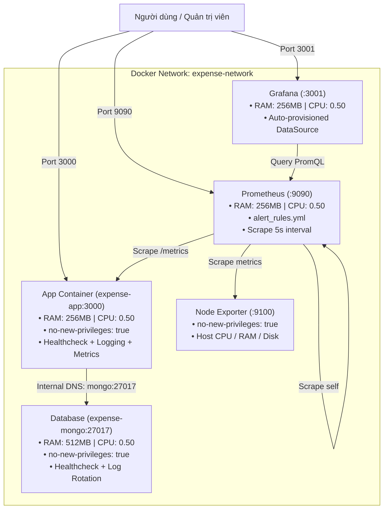

# Ứng Dụng Quản Lý Chi Tiêu Cá Nhân (DevOps Project - Final Release v1.0.0)

Dự án ứng dụng web Quản lý chi tiêu cá nhân xây dựng bằng **Node.js + Express + Mongoose + EJS**, phục vụ cho đồ án môn học DevOps qua 4 giai đoạn tiến hóa liên tục:
- **Tuần 1:** Khởi tạo kiến trúc mã nguồn chuẩn MVC & RESTful Web Application.
- **Tuần 2:** Đóng gói ứng dụng (Containerization với Docker/Docker Compose) & Tự động hóa CI/CD với GitHub Actions (Self-hosted Runner).
- **Tuần 3:** Giám sát toàn diện (Monitoring với Prometheus & Grafana), Thu thập số liệu ứng dụng (`prom-client`), Ghi log có cấu trúc (Structured Logging), Advanced Healthcheck, Tự động hóa sao lưu (MongoDB Backup/Restore) & Sổ tay xử lý sự cố (Troubleshooting Playbook).
- **Tuần 4:** DevSecOps (Bảo mật với `helmet`, chống DDoS/Brute-force với `express-rate-limit`, `npm audit`), Hệ thống cảnh báo tự động (Prometheus Alerting Rules), Giới hạn tài nguyên phần cứng (`mem_limit`, `cpus`, `no-new-privileges`), Kiểm thử tải (`load-test.sh`), Tự động hóa Cron Backup hàng ngày & Đóng gói phát hành bản chính thức `v1.0.0`.

---

## Cấu trúc thư mục dự án

```text
Quan-Li-Chi-Tieu/
├── .github/
│   └── workflows/
│       └── ci-cd.yml                     # Pipeline CI/CD 6 bước (tích hợp Security Audit & Header Verification)
├── backups/                              # Thư mục chứa các bản sao lưu database (.gz)
│   └── .gitkeep
├── docs/
│   ├── week1-evidence/                   # Tài liệu minh chứng tuần 1
│   ├── week2-evidence/                   # Tài liệu minh chứng tuần 2 (Docker, Test, CI/CD)
│   ├── week3-evidence/                   # Tài liệu minh chứng tuần 3 (Monitoring, Logging, Troubleshooting)
│   │   ├── README.md
│   │   └── TROUBLESHOOTING.md            # Sổ tay xử lý 3 kịch bản sự cố thực tế & mở rộng LVM
│   └── week4-evidence/                   # Tài liệu minh chứng tuần 4 & Báo cáo tổng kết đồ án
│       ├── README.md
│       └── FINAL_REPORT.md               # Báo cáo tổng kết đồ án DevOps toàn diện (Final Release v1.0.0)
├── monitoring/                           # Cấu hình Monitoring & Alerting Stack
│   ├── alert_rules.yml                   # 4 luật cảnh báo Prometheus (AppDown, HighLatency, 5xx, LowDisk)
│   ├── grafana/
│   │   └── provisioning/
│   │       └── datasources/
│   │           └── datasource.yml        # Tự động nạp Prometheus DataSource vào Grafana
│   └── prometheus.yml                    # Cấu hình scrape targets & nạp alert_rules.yml
├── scripts/
│   ├── backup-mongo.sh                   # Script sao lưu & khôi phục MongoDB có nén và timestamp
│   ├── load-test.sh                      # Script kiểm thử tải gửi 200 HTTP requests tạo spike Grafana
│   └── setup-cron-backup.sh              # Script đăng ký Cron Job sao lưu tự động lúc 02:00 sáng
├── src/
│   ├── models/
│   │   └── Expense.js                    # Mongoose Schema & Model cho khoản chi tiêu
│   ├── routes/
│   │   └── expenseRoutes.js              # Định tuyến CRUD chi tiêu (GET, POST, POST delete)
│   ├── views/
│   │   └── index.ejs                     # Giao diện Bootstrap 5 CDN hiện đại
│   └── app.js                            # Express Server, Helmet, Rate Limit, Logging, Healthcheck & Metrics
├── tests/
│   └── expense.test.js                   # Automated tests với Jest (Model validation + Security Headers + v1.0.0)
├── .dockerignore                         # Loại trừ các file không cần thiết khi đóng gói Docker
├── .env                                  # Biến môi trường cục bộ (được .gitignore bảo vệ)
├── .env.example                          # File mẫu biến môi trường
├── .gitignore                            # Cấu hình bỏ qua các file/thư mục Git
├── Dockerfile                            # Dockerfile tối ưu (Node 20 Alpine, non-root user)
├── docker-compose.yml                    # Điều phối 5 containers (Resource limits + Security options)
├── package.json                          # Khai báo dependencies, devDependencies và test script
└── README.md                             # Hướng dẫn chi tiết dự án
```

---

## 1. Kiểm Thử Tự Động (Automated Testing & Security Verification)

Dự án sử dụng **Jest** và **Supertest** để kiểm thử tự động tính toàn vẹn của ứng dụng với **5 test cases**:
1. Tạo khoản chi tiêu hợp lệ (`title`, `amount`, `category`) thành công.
2. Báo lỗi validation nếu thiếu `title`.
3. Báo lỗi validation nếu `amount` là số âm (`< 0`).
4. Kiểm tra HTTP Security Headers từ Helmet (`x-content-type-options: nosniff`).
5. Kiểm tra endpoint `/health` trả về phiên bản phát hành chính thức `version: '1.0.0'`.

Chạy kiểm thử:
```bash
npm test
```

> **Lưu ý:** Script `"test"` được cấu hình là `"jest tests/ --runInBand --forceExit"` để Jest **chỉ quét thư mục `tests/`**, tránh quét nhầm thư mục chứa runner (`actions-runner`) khi chạy trên self-hosted server. Nếu có bất kỳ test case nào thất bại, lệnh sẽ trả về mã lỗi (`exit code != 0`), làm dừng pipeline CI/CD ngay lập tức.

---

## 2. Đóng Gói và Chạy với Docker Compose (Week 4 Production Architecture)

Hệ thống triển khai 5 dịch vụ liên kết chặt chẽ trong bridge network `expense-network`, đồng thời áp đặt các chính sách an toàn bảo mật và giới hạn tài nguyên nghiêm ngặt:



### 2.1. Củng cố Bảo mật & Giới hạn Tài nguyên:
- **`security_opt: ["no-new-privileges:true"]`**: Kích hoạt trên `app`, `mongo`, `prometheus`, `node-exporter` nhằm ngăn chặn leo thang đặc quyền từ bên trong container.
- **Giới hạn phần cứng (Resource Limits)**:
  - `app`: `mem_limit: 256m`, `cpus: 0.50`
  - `mongo`: `mem_limit: 512m`, `cpus: 0.50`
  - `prometheus`: `mem_limit: 256m`, `cpus: 0.50`
  - `grafana`: `mem_limit: 256m`, `cpus: 0.50`
- **Docker Log Rotation:** Driver `json-file` với `max-size: "10m"` và `max-file: "3"` cho mọi container để bảo vệ ổ cứng máy chủ khỏi sự cố tràn đĩa.

### 2.2. Các lệnh điều khiển hệ thống:

Khởi chạy toàn bộ hệ thống (build image và chạy nền):
```bash
docker compose up -d --build
```

Kiểm tra trạng thái sức khỏe (Health status) của các container:
```bash
docker compose ps
```
*Các container sẽ hiển thị trạng thái `Up (healthy)`.*

Xem mức sử dụng RAM và CPU thực tế so với giới hạn:
```bash
docker stats
```

Xem log ứng dụng có cấu trúc theo thời gian thực:
```bash
docker compose logs -f app
```

Dừng và gỡ bỏ toàn bộ containers (giữ nguyên volumes):
```bash
docker compose down
```

---

## 3. Bảo Mật Ứng Dụng (DevSecOps Hardening)

### 3.1. Helmet HTTP Security Headers
Ứng dụng tích hợp thư viện `helmet` tại `src/app.js` để tự động chèn các tiêu chuẩn bảo vệ:
- `X-Content-Type-Options: nosniff`: Chống tấn công MIME type sniffing.
- `X-Frame-Options: SAMEORIGIN`: Ngăn ngừa Clickjacking qua iframe.
- `X-Download-Options: noopen`: Chặn trình duyệt tự ý thực thi file tải xuống.
- `X-XSS-Protection: 0`: Vô hiệu hóa XSS Auditor cũ.

### 3.2. Rate Limiting (Chống DDoS & Brute-Force)
Tích hợp `express-rate-limit` với các tham số:
- **Ngưỡng giới hạn:** Tối đa **120 requests / 1 phút cho mỗi địa chỉ IP**.
- **Cơ chế Skip thông minh:** Bỏ qua endpoint `/health` và `/metrics` để đảm bảo hệ thống giám sát Prometheus và test script hoạt động liên tục không bị gián đoạn (HTTP 429).

### 3.3. Tự động Quét Lỗ Hổng (Security Audit)
Pipeline CI/CD tích hợp công cụ kiểm tra bảo mật tự động:
```bash
npm audit --omit=dev --audit-level=high || true
```

---

## 4. Hệ Thống Giám Sát & Cảnh Báo (Prometheus Alerting & Grafana)

### 4.1. Cấu hình Cảnh báo Tự động ([`monitoring/alert_rules.yml`](file:///monitoring/alert_rules.yml))
Prometheus tự động đánh giá 4 luật cảnh báo theo chu kỳ 5 giây:
1. **`ExpenseAppDown` (Critical):** Kích hoạt khi container `expense-app` mất phản hồi quá 30 giây (`up == 0`).
2. **`HighHttpErrorRate` (Warning):** Kích hoạt khi tỷ lệ lỗi HTTP 5xx vượt quá 5% lưu lượng trong 1 phút.
3. **`HighResponseLatency` (Warning):** Kích hoạt khi thời gian phản hồi trung bình vượt quá 0.5 giây trong 1 phút.
4. **`HostLowDiskSpace` (Critical):** Kích hoạt khi dung lượng ổ cứng khả dụng trên phân vùng root (`/`) của máy ảo dưới 15%.

### 4.2. Advanced Healthcheck (`GET /health`)
- Trả về mã **HTTP 200 OK** khi cơ sở dữ liệu hoạt động bình thường:
  ```json
  {
    "status": "UP",
    "database": "CONNECTED",
    "uptime": 245.89,
    "version": "1.0.0",
    "timestamp": "2026-11-10T09:20:00.123Z"
  }
  ```
- Trả về mã **HTTP 503 Service Unavailable** khi MongoDB mất kết nối.

---

## 5. Kiểm Thử Tải (Load Testing) & Cron Backup Tự Động

### 5.1. Kiểm thử tải với `scripts/load-test.sh`
Script tự động gửi **200 requests liên tục** vào ứng dụng để kiểm chứng Rate Limiter và sinh dữ liệu đồ thị trên Grafana:
```bash
chmod +x scripts/load-test.sh
./scripts/load-test.sh
```
*Kết quả:* Thống kê chi tiết số request thành công, số request bị Rate Limit (HTTP 429), số request lỗi (5xx) và tốc độ xử lý (Requests/giây - RPS).

### 5.2. Đăng ký Cronjob sao lưu tự động với `scripts/setup-cron-backup.sh`
Script tự động nạp lịch chạy sao lưu MongoDB vào `crontab` của hệ thống:
```bash
chmod +x scripts/setup-cron-backup.sh
./scripts/setup-cron-backup.sh --install
```
- **Lịch chạy:** `0 2 * * *` (Lúc 02:00 sáng hàng ngày).
- **Lệnh thực thi:** Gọi `scripts/backup-mongo.sh --backup`.
- **Chính sách lưu trữ:** Tự động dọn dẹp các bản sao lưu cũ quá 7 ngày.
- **Kiểm tra trạng thái:** `./scripts/setup-cron-backup.sh --status` hoặc `crontab -l`.

---

## 6. Tự Động Hóa CI/CD với GitHub Actions (6 Bước Hoàn Chỉnh)

Pipeline CI/CD định nghĩa tại [`.github/workflows/ci-cd.yml`](file:///.github/workflows/ci-cd.yml) thực thi tự động trên **Self-hosted Runner**:
1. **Bước 1: Checkout code** (`actions/checkout@v4`).
2. **Bước 2: Cài đặt thư viện** (`npm ci`).
3. **Bước 3: Quét bảo mật phụ thuộc (DevSecOps Audit)** (`npm audit --omit=dev --audit-level=high || true`).
4. **Bước 4: Chạy Automated Tests** (`npm test` với 5 test cases Jest).
5. **Bước 5: Tạo file .env từ GitHub Secrets** (`PORT=3000`, `MONGO_URI`).
6. **Bước 6: Deploy tự động & Hậu kiểm (Post-deployment Verification)**:
   - Khởi động lại container với `docker compose up -d --build`.
   - Dọn dẹp dangling images với `docker image prune -f`.
   - Kiểm tra Healthcheck (`curl -f http://localhost/health`).
   - Kiểm tra Security Response Headers (`curl -I http://localhost/health`).

---

## 7. Bảng Điều Hướng Dịch Vụ (Endpoints & Port Mapping - v1.0.0)

| Dịch vụ | Địa chỉ truy cập | Giao thức | Chức năng |
| :--- | :--- | :--- | :--- |
| **Ứng dụng Web** | `http://<HOST_IP>:3000/` | HTTP | Trang chủ (tự động chuyển hướng sang `/expenses`) |
| **Quản lý chi tiêu**| `http://<HOST_IP>:3000/expenses` | HTTP | Giao diện CRUD chi tiêu (được bảo vệ bởi Rate Limiter) |
| **Health Check** | `http://<HOST_IP>:3000/health` | HTTP | Trạng thái UP/DOWN, DB connection, uptime, version v1.0.0 |
| **Prometheus Metrics**| `http://<HOST_IP>:3000/metrics` | HTTP | Dữ liệu đo đạc chuẩn Prometheus (CPU, RAM, HTTP metrics) |
| **Prometheus UI** | `http://<HOST_IP>:9090` | HTTP | Bảng điều khiển Prometheus, Alerts (`/alerts`), Targets (`/targets`) |
| **Grafana UI** | `http://<HOST_IP>:3001` | HTTP | Dashboard trực quan hóa (User: `admin` / Pass: `admin`) |
| **Node Exporter** | `http://<HOST_IP>:9100/metrics` | HTTP (Nội bộ) | Chỉ số tài nguyên máy chủ host (CPU, RAM, Disk) |
