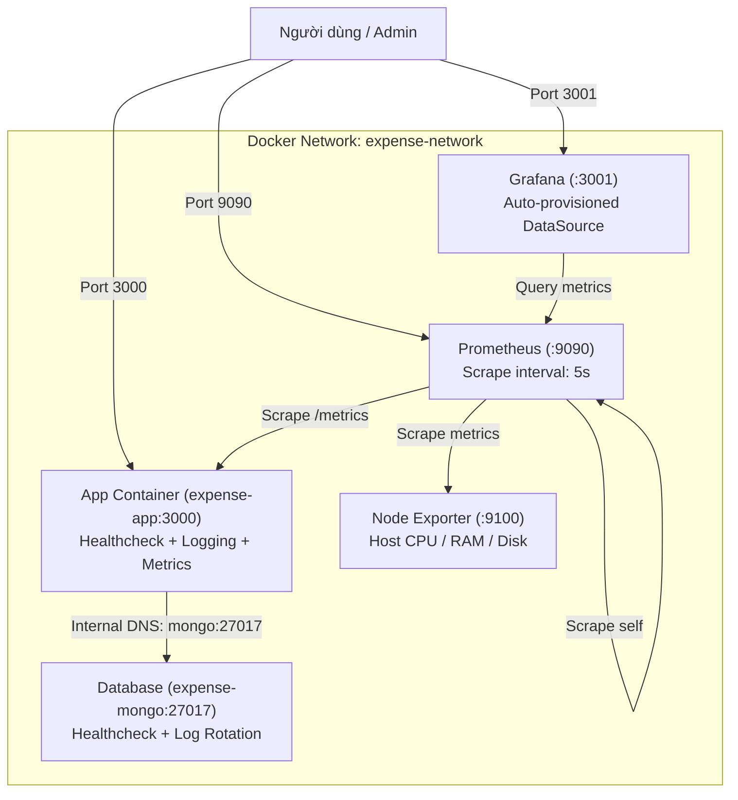

# Ứng Dụng Quản Lý Chi Tiêu Cá Nhân (DevOps Project)

Dự án ứng dụng web Quản lý chi tiêu cá nhân xây dựng bằng **Node.js + Express + Mongoose + EJS**, phục vụ cho đồ án môn học DevOps qua các giai đoạn phát triển:
- **Tuần 1:** Khởi tạo kiến trúc mã nguồn & RESTful Web Application.
- **Tuần 2:** Đóng gói ứng dụng (Containerization với Docker/Docker Compose) & Tự động hóa CI/CD với GitHub Actions (Self-hosted Runner).
- **Tuần 3:** Giám sát toàn diện (Monitoring với Prometheus & Grafana), Thu thập số liệu ứng dụng (`prom-client`), Ghi log có cấu trúc (Structured Logging), Advanced Healthcheck, Tự động hóa sao lưu (MongoDB Backup/Restore) & Sổ tay xử lý sự cố (Troubleshooting Playbook).

---

## 📁 Cấu trúc thư mục dự án

```text
Quan-Li-Chi-Tieu/
├── .github/
│   └── workflows/
│       └── ci-cd.yml                     # GitHub Actions Workflow tự động test & deploy
├── backups/                              # Thư mục chứa các bản sao lưu database (.gz)
│   └── .gitkeep
├── docs/
│   ├── week1-evidence/                   # Tài liệu minh chứng tuần 1
│   ├── week2-evidence/                   # Tài liệu minh chứng tuần 2 (Docker, Test, CI/CD)
│   └── week3-evidence/                   # Tài liệu minh chứng tuần 3 (Monitoring, Logging, Troubleshooting)
│       ├── README.md
│       └── TROUBLESHOOTING.md            # Sổ tay xử lý 3 kịch bản sự cố thực tế
├── monitoring/                           # Cấu hình Monitoring Stack
│   ├── grafana/
│   │   └── provisioning/
│   │       └── datasources/
│   │           └── datasource.yml        # Tự động nạp Prometheus DataSource vào Grafana
│   └── prometheus.yml                    # Cấu hình scrape targets (Prometheus, App, Node Exporter)
├── scripts/
│   └── backup-mongo.sh                   # Script tự động sao lưu & khôi phục MongoDB
├── src/
│   ├── models/
│   │   └── Expense.js                    # Mongoose Schema & Model cho khoản chi tiêu
│   ├── routes/
│   │   └── expenseRoutes.js              # Định tuyến CRUD chi tiêu (GET, POST, POST delete)
│   ├── views/
│   │   └── index.ejs                     # Giao diện Bootstrap 5 CDN hiện đại
│   └── app.js                            # Express Server, Structured Logging, Healthcheck & Metrics
├── tests/
│   └── expense.test.js                   # Automated tests với Jest cho model Expense
├── .dockerignore                         # Loại trừ các file không cần thiết khi đóng gói Docker
├── .env                                  # Biến môi trường cục bộ (được .gitignore bảo vệ)
├── .env.example                          # File mẫu biến môi trường
├── .gitignore                            # Cấu hình bỏ qua các file/thư mục Git
├── Dockerfile                            # Dockerfile tối ưu (Node 20 Alpine, non-root user)
├── docker-compose.yml                    # Điều phối 5 containers (App, Mongo, Node Exporter, Prometheus, Grafana)
├── package.json                          # Khai báo dependencies, devDependencies và test script
└── README.md                             # Hướng dẫn chi tiết dự án
```

---

## 🧪 1. Kiểm Thử Tự Động (Automated Testing)

Dự án sử dụng **Jest** để kiểm thử tự động tính toàn vẹn của model `Expense` với 3 kịch bản:
1. Tạo khoản chi tiêu hợp lệ (`title`, `amount`, `category`) thành công.
2. Báo lỗi validation nếu thiếu `title`.
3. Báo lỗi validation nếu `amount` là số âm (`< 0`).

Chạy kiểm thử:
```bash
npm test
```

> **Lưu ý:** Script `"test"` được cấu hình là `"jest tests/ --runInBand --forceExit"` để Jest **chỉ quét thư mục `tests/`**, tránh quét nhầm thư mục chứa runner (`actions-runner`) khi chạy trên self-hosted server. Nếu có bất kỳ test case nào thất bại, lệnh sẽ trả về mã lỗi (`exit code != 0`), làm dừng pipeline CI/CD ngay lập tức.

---

## 🐳 2. Đóng Gói và Chạy với Docker Compose (Week 3 Architecture)

Hệ thống triển khai 5 dịch vụ liên kết chặt chẽ trong bridge network `expense-network`:



### 2.1. Chi tiết các dịch vụ trong `docker-compose.yml`:
1. **app (`expense-app`)**:
   - Chạy trên cổng nội bộ `3000`, ánh xạ ra host tại `127.0.0.1:3000:3000`.
   - **Healthcheck:** Kiểm tra định kỳ qua `wget --spider http://127.0.0.1:3000/health` (interval 15s, timeout 5s, retries 3).
   - **Phụ thuộc điều kiện:** `depends_on: mongo: condition: service_healthy` (chỉ khởi động ứng dụng khi MongoDB đã thực sự sẵn sàng nhận kết nối).
   - **Log Rotation:** Giới hạn file log bằng `json-file` driver (`max-size: "10m"`, `max-file: "3"`).

2. **mongo (`expense-mongo`)**:
   - Image chính thức `mongo:7.0`, lưu trữ dữ liệu bền vững qua volume `mongo_data`.
   - **Healthcheck:** Kiểm tra lệnh ping quản trị qua `mongosh --eval "db.adminCommand('ping')"` (interval 10s, timeout 5s, retries 5).
   - **Log Rotation:** Giới hạn log với `max-size: "10m"`, `max-file: "3"` chống tràn ổ cứng.

3. **node-exporter (`expense-node-exporter`)**:
   - Image `prom/node-exporter:latest`, thu thập chỉ số phần cứng (CPU, Memory, Disk IO, Network) của máy chủ host tại cổng `9100`.

4. **prometheus (`expense-prometheus`)**:
   - Image `prom/prometheus:latest`, mở cổng `9090:9090`.
   - Mount file cấu hình `./monitoring/prometheus.yml` và volume lưu trữ số liệu `prometheus_data`.
   - Chu kỳ thu thập số liệu (scrape interval) là `5s` cho cả 3 targets.

5. **grafana (`expense-grafana`)**:
   - Image `grafana/grafana:latest`, ánh xạ cổng `3001:3000` (truy cập tại `http://<IP_HOST>:3001`).
   - Tự động nạp Prometheus DataSource ngay khi khởi động thông qua cơ chế provisioning (`./monitoring/grafana/provisioning`).
   - Tài khoản mặc định: User `admin` / Password `admin`.

### 2.2. Các lệnh điều khiển hệ thống:

Khởi chạy toàn bộ hệ thống (build image và chạy nền):
```bash
docker compose up -d --build
```

Kiểm tra trạng thái sức khỏe (Health status) của các container:
```bash
docker compose ps
```
*Các container sẽ hiển thị trạng thái `Up (healthy)`.*

Xem log ứng dụng có cấu trúc theo thời gian thực:
```bash
docker compose logs -f app
```

Dừng và gỡ bỏ toàn bộ containers (giữ nguyên volumes):
```bash
docker compose down
```

---

## 📊 3. Hệ Thống Giám Sát & Logging (Monitoring & Observability)

### 3.1. Ghi Log có cấu trúc (Structured Logging)
Mọi yêu cầu HTTP gửi đến hệ thống đều được ghi log ra `stdout` theo chuẩn thống nhất để dễ dàng thu thập và phân tích:
```text
[ISO_TIMESTAMP] [INFO] METHOD URL STATUS - DURATION ms
```
*Ví dụ log thực tế:*
```text
[2026-11-03T08:50:12.345Z] [INFO] GET /expenses 200 - 14 ms
[2026-11-03T08:50:15.678Z] [INFO] POST /expenses 302 - 25 ms
[2026-11-03T08:50:20.123Z] [INFO] GET /health 200 - 2 ms
```

### 3.2. Prometheus Application Metrics (`GET /metrics`)
Ứng dụng tích hợp thư viện `prom-client` để xuất bản số liệu theo chuẩn OpenMetrics/Prometheus:
- **Default Metrics:** Tự động thu thập CPU usage, Virtual Memory, Resident Memory, Heap Size, Event Loop Lag của tiến trình Node.js (`nodejs_*`, `process_*`).
- **HTTP Request Duration Histogram (`http_request_duration_seconds`):** Đo thời gian xử lý request theo method, route và mã phản hồi HTTP (`buckets: [0.01, 0.05, 0.1, 0.3, 0.5, 1, 1.5, 2, 5]`).
- **HTTP Requests Total Counter (`http_requests_total`):** Đếm tổng số lượng request theo nhãn `method`, `route`, `status_code`.

### 3.3. Advanced Healthcheck (`GET /health`)
Endpoint sức khỏe phản ánh chính xác trạng thái kết nối Database thời gian thực:
- **Khi MongoDB hoạt động bình thường:** Trả về mã **HTTP 200 OK**:
  ```json
  {
    "status": "UP",
    "database": "CONNECTED",
    "uptime": 245.89,
    "timestamp": "2026-11-03T08:55:00.123Z"
  }
  ```
- **Khi MongoDB mất kết nối:** Trả về mã **HTTP 503 Service Unavailable**:
  ```json
  {
    "status": "DOWN",
    "database": "DISCONNECTED",
    "timestamp": "2026-11-03T08:55:10.456Z"
  }
  ```

---

## 💾 4. Tự Động Hóa Sao Lưu & Khôi Phục MongoDB (Backup & Disaster Recovery)

Dự án cung cấp script bash [**`scripts/backup-mongo.sh`**](file:///scripts/backup-mongo.sh) giúp tự động sao lưu dữ liệu từ container `expense-mongo` ra thư mục `backups/` theo định dạng nén `.gz` kèm timestamp và tự động dọn dẹp các bản backup cũ hơn 7 ngày.

### 4.1. Lệnh thực hiện sao lưu:
```bash
chmod +x scripts/backup-mongo.sh
./scripts/backup-mongo.sh --backup
```
*Kết quả:* Tạo file bản lưu tại `backups/mongo_backup_quanlychitieu_YYYYMMDD_HHMMSS.gz`.

### 4.2. Lệnh liệt kê các bản sao lưu:
```bash
./scripts/backup-mongo.sh --list
```

### 4.3. Lệnh khôi phục cơ sở dữ liệu:
```bash
./scripts/backup-mongo.sh --restore backups/mongo_backup_quanlychitieu_20261103_120000.gz
```
Hoặc dùng lệnh Docker CLI trực tiếp:
```bash
docker exec -i expense-mongo mongorestore --db quanlychitieu --archive --gzip --drop < backups/<ten_file>.gz
```

---

## 🛠️ 5. Sổ Tay Vận Hành & Xử Lý Sự Cố (Troubleshooting Playbook)

Tài liệu chi tiết hướng dẫn xử lý 3 kịch bản sự cố thực tế trong môi trường production được lưu trữ tại [**`docs/week3-evidence/TROUBLESHOOTING.md`**](file:///docs/week3-evidence/TROUBLESHOOTING.md):

1. **Sự cố 1: Lỗi kết nối MongoDB do cấu hình sai `MONGO_URI`**
   - *Nguyên nhân:* Nhập `127.0.0.1` thay vì service name `mongo`.
   - *Cách chẩn đoán:* Phân tích mạng container Docker, DNS internal resolution và log Mongoose.
   - *Khắc phục:* Cập nhật biến môi trường sang `mongodb://mongo:27017/quanlychitieu`.
2. **Sự cố 2: Container `expense-mongo` bị dừng đột ngột (OOM / Crash)**
   - *Nguyên nhân:* Linux OOM Killer (Exit code 137), kẹt `mongod.lock`.
   - *Cách chẩn đoán:* `docker compose ps -a`, `docker inspect`, `dmesg -T`.
   - *Khắc phục:* Gỡ lock, khởi động lại, kiểm tra Mongoose auto-reconnect và khôi phục từ file backup.
3. **Sự cố 3: Máy ảo Ubuntu đầy ổ cứng 98% (`No space left on device`)**
   - *Nguyên nhân:* Docker logs phình to không giới hạn, LVM volume root bị giới hạn 50%.
   - *Xử lý khẩn cấp:* `docker system prune -af --volumes`, `journalctl --vacuum-size=100M`.
   - *Mở rộng LVM online không reboot:* `growpart`, `pvresize`, `lvextend`, `resize2fs`.
   - *Phòng ngừa vĩnh viễn:* Cấu hình Docker log rotation `max-size: 10m`, `max-file: 3`.

---

## 🚀 6. Tự Động Hóa CI/CD với GitHub Actions

Pipeline CI/CD tự động thực hiện trên **Self-hosted Runner**:
1. **Bước 1: Checkout code** (`actions/checkout@v4`).
2. **Bước 2: Cài đặt thư viện** (`npm ci`).
3. **Bước 3: Chạy Automated Tests** (`npm test` với `"jest tests/ --runInBand --forceExit"`).
4. **Bước 4: Tạo file .env từ GitHub Secrets** (`PORT=3000`, `MONGO_URI=mongodb://mongo:27017/quanlychitieu`).
5. **Bước 5: Deploy tự động bằng Docker Compose** (`docker compose up -d --build`, `docker image prune -f`, Healthcheck probe).

---

## 🌐 7. Bảng Điều Hướng Đường Dẫn (Endpoints & Port Mapping)

| Dịch vụ | Địa chỉ truy cập | Giao thức | Chức năng |
| :--- | :--- | :--- | :--- |
| **Ứng dụng Web** | `http://<HOST_IP>:3000/` | HTTP | Trang chủ (tự động chuyển hướng sang `/expenses`) |
| **Quản lý chi tiêu**| `http://<HOST_IP>:3000/expenses` | HTTP | Giao diện CRUD danh sách chi tiêu |
| **Health Check** | `http://<HOST_IP>:3000/health` | HTTP | Trả về trạng thái UP/DOWN, DB connection, uptime, timestamp |
| **Prometheus Metrics**| `http://<HOST_IP>:3000/metrics` | HTTP | Dữ liệu đo đạc chuẩn Prometheus (CPU, RAM, HTTP metrics) |
| **Prometheus UI** | `http://<HOST_IP>:9090` | HTTP | Bảng điều khiển Prometheus, kiểm tra Scrape Targets (`/targets`) |
| **Grafana UI** | `http://<HOST_IP>:3001` | HTTP | Dashboard trực quan hóa (User: `admin` / Pass: `admin`) |
| **Node Exporter** | `http://<HOST_IP>:9100/metrics` | HTTP (Nội bộ) | Chỉ số tài nguyên máy chủ host (CPU, RAM, Disk) |
