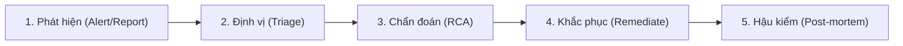
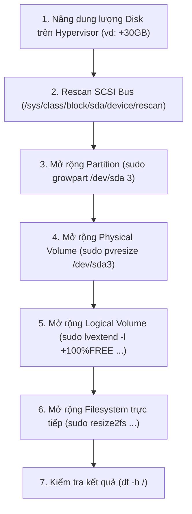

# Sổ Tay Vận Hành & Xử Lý Sự Cố (DevOps Troubleshooting Playbook)
> **Dự án:** Quản Lý Chi Tiêu Cá Nhân (Expense Tracker)  
> **Giai đoạn:** Checkpoint Week 3 - Monitoring, Logging, Healthchecks, Backup & Troubleshooting  
> **Môi trường:** Ubuntu 22.04 LTS / Docker Compose / Node.js 20 / MongoDB 7.0 / Prometheus / Grafana  

---

## 📑 Mục lục
1. [Tổng quan quy trình phản ứng sự cố (Incident Response Workflow)](#1-tổng-quan-quy-trình-phản-ứng-sự-cố)
2. [Sự cố 1: Lỗi kết nối MongoDB do sai biến môi trường MONGO_URI](#2-sự-cố-1-lỗi-kết-nối-mongodb-do-sai-biến-môi-trường-mongo_uri)
3. [Sự cố 2: Container MongoDB bị dừng đột ngột (Crash / OOM) và cách khôi phục](#3-sự-cố-2-container-mongodb-bị-dừng-đột-ngột-crash--oom-và-cách-khôi-phục)
4. [Sự cố 3: Máy ảo Ubuntu đầy ổ cứng 98% (No space left on device) & Quy trình mở rộng LVM](#4-sự-cố-3-máy-ảo-ubuntu-đầy-ổ-cứng-98-no-space-left-on-device--quy-trình-mở-rộng-lvm)
5. [Checklist kiểm tra định kỳ trước khi bàn giao hệ thống](#5-checklist-kiểm-tra-định-kỳ)

---

## 1. Tổng quan quy trình phản ứng sự cố

Khi hệ thống gặp cảnh báo từ Grafana/Prometheus hoặc người dùng phản ánh, DevOps Engineer thực hiện theo chu trình 5 bước chuẩn SRE:



- **Bước 1 (Phát hiện):** Nhận cảnh báo qua Prometheus Alertmanager, Grafana Dashboard hoặc Healthcheck Fail.
- **Bước 2 (Định vị):** Kiểm tra trạng thái các container (`docker compose ps`) và log hệ thống.
- **Bước 3 (Chẩn đoán):** Phân tích log ứng dụng, MongoDB, kernel dmesg, dung lượng đĩa.
- **Bước 4 (Khắc phục):** Áp dụng giải pháp hotfix và permanent fix theo Playbook bên dưới.
- **Bước 5 (Hậu kiểm):** Kiểm tra endpoint `/health`, chỉ số Grafana trở về bình thường và lưu bằng chứng.

---

## 2. Sự cố 1: Lỗi kết nối MongoDB do sai biến môi trường `MONGO_URI`

### 2.1. Triệu chứng (Symptoms)
- Khi truy cập giao diện ứng dụng web tại `http://<IP_MAY_AO>:3000/expenses`, trang hiển thị thông báo lỗi:
  > *"Không thể tải danh sách chi tiêu. Vui lòng kiểm tra kết nối cơ sở dữ liệu."*
- Kiểm tra endpoint Healthcheck `http://<IP_MAY_AO>:3000/health` nhận mã phản hồi **HTTP 503 Service Unavailable**:
  ```json
  {
    "status": "DOWN",
    "database": "DISCONNECTED",
    "timestamp": "2026-11-03T08:15:20.123Z"
  }
  ```
- Prometheus scrape mục `expense-app` ghi nhận status code 503 và 500 tăng đột biến.

### 2.2. Nguyên nhân gốc rễ (Root Cause Analysis - RCA)
- Biến môi trường `MONGO_URI` được cấu hình là `mongodb://127.0.0.1:27017/quanlychitieu` hoặc `mongodb://localhost:27017/quanlychitieu`.
- **Bản chất kỹ thuật mạng Docker:**
  - Mỗi Docker container sở hữu một Network Namespace và địa chỉ IP loopback (`127.0.0.1`) riêng biệt.
  - Khi ứng dụng trong container `expense-app` kết nối tới `127.0.0.1:27017`, nó đang tìm tiến trình MongoDB chạy ngay bên trong chính container `expense-app`, nơi không có MongoDB nào đang lắng nghe.
  - Trong Docker Compose network (`expense-network`), các container phải giao tiếp với nhau bằng **Service Name** (tên dịch vụ `mongo`), được phân giải địa chỉ IP nội bộ qua Docker Embedded DNS Server (`127.0.0.11`).

### 2.3. Lệnh kiểm tra & Chẩn đoán (Investigation Commands)

Kiểm tra log của container ứng dụng:
```bash
docker compose logs app --tail 50
```
*Đoạn log lỗi điển hình:*
```text
[2026-11-03T08:15:20.123Z] [INFO] GET /health 503 - 2 ms
❌ Lỗi kết nối MongoDB (mongodb://127.0.0.1:27017/quanlychitieu): connect ECONNREFUSED 127.0.0.1:27017
MongooseServerSelectionError: connect ECONNREFUSED 127.0.0.1:27017
    at _handleConnectionErrors (/app/node_modules/mongoose/lib/connection.js:899:11)
```

Kiểm tra biến môi trường đang nạp vào container:
```bash
docker compose exec app printenv MONGO_URI
# Kết quả sai: mongodb://127.0.0.1:27017/quanlychitieu
```

Kiểm tra phân giải DNS từ bên trong container `app` sang `mongo`:
```bash
docker compose exec app ping -c 2 mongo
# Nếu DNS đúng, lệnh ping sẽ trả về IP nội bộ trong dải 172.x.x.x
```

### 2.4. Quy trình khắc phục từng bước (Remediation Steps)

1. **Sửa file cấu hình `.env`:**
   Mở file `.env` trên máy chủ và cập nhật lại chuỗi kết nối:
   ```env
   PORT=3000
   MONGO_URI=mongodb://mongo:27017/quanlychitieu
   NODE_ENV=production
   ```

2. **Áp dụng cấu hình và khởi động lại dịch vụ:**
   ```bash
   docker compose up -d app
   ```

3. **Hậu kiểm trạng thái (Verification):**
   ```bash
   # 1. Kiểm tra log khởi động
   docker compose logs app --tail 20 | grep "Kết nối MongoDB thành công"

   # 2. Kiểm tra Healthcheck endpoint
   curl -i http://127.0.0.1:3000/health
   ```
   *Kết quả kỳ vọng (HTTP 200 OK):*
   ```http
   HTTP/1.1 200 OK
   Content-Type: application/json; charset=utf-8

   {
     "status": "UP",
     "database": "CONNECTED",
     "uptime": 12.45,
     "timestamp": "2026-11-03T08:16:00.000Z"
   }
   ```

---

## 3. Sự cố 2: Container MongoDB bị dừng đột ngột (Crash / OOM) và cách khôi phục

### 3.1. Triệu chứng (Symptoms)
- Người dùng không thể tạo mới, cập nhật hoặc xóa khoản chi tiêu.
- Endpoint `/health` trả về mã lỗi **HTTP 503**:
  ```json
  {
    "status": "DOWN",
    "database": "DISCONNECTED",
    "timestamp": "2026-11-03T09:00:15.000Z"
  }
  ```
- Lệnh `docker compose ps` cho thấy container `expense-mongo` ở trạng thái `Exit 137` hoặc `Exit 14` hoặc `unhealthy`.
- Docker Compose tự động đánh dấu container `expense-app` là `unhealthy` do healthcheck của app thất bại.

### 3.2. Nguyên nhân gốc rễ (Root Cause Analysis - RCA)
- **Exit Code 137 (OOM Killer):** Máy ảo Ubuntu bị cạn kiệt bộ nhớ RAM vật lý (Out of Memory). Linux Kernel `oom-killer` can thiệp và tiêu diệt tiến trình ngốn nhiều bộ nhớ nhất (thường là `mongod`).
- **File Lock bị kẹt (`mongod.lock`):** Do máy ảo bị tắt đột ngột (hard reboot/power outage), MongoDB chưa kịp đóng clean session, để lại cờ khóa dữ liệu.
- **Lỗi phân quyền Volume:** Thư mục `mongo_data` bị thay đổi ownership trên Host khiến user `mongodb` (UID 999) không có quyền ghi.

### 3.3. Lệnh kiểm tra & Chẩn đoán (Investigation Commands)

Kiểm tra trạng thái container và mã thoát (Exit Code):
```bash
docker compose ps -a
docker inspect expense-mongo --format 'Status: {{.State.Status}} | ExitCode: {{.State.ExitCode}} | OOMKilled: {{.State.OOMKilled}}'
```
*Nếu `OOMKilled: true` hoặc `ExitCode: 137`, chứng tỏ máy chủ bị tràn RAM.*

Kiểm tra log của MongoDB trước khi bị dừng:
```bash
docker compose logs mongo --tail 100
```

Kiểm tra log hệ thống host xem Linux OOM Killer có kích hoạt không:
```bash
sudo dmesg -T | grep -i -E "oom|out of memory|killed process"
```

### 3.4. Quy trình khắc phục từng bước (Remediation Steps)

#### Bước 1: Khởi động lại container MongoDB
```bash
docker compose up -d mongo
```

#### Bước 2: Xử lý trường hợp MongoDB từ chối khởi động do kẹt file lock
Nếu container khởi động lại nhưng ngay lập tức thoát với mã lỗi liên quan đến `WiredTiger.lock` hoặc `mongod.lock`:
```bash
# 1. Tạm dừng container
docker compose stop mongo

# 2. Xóa lockfile an toàn qua container phụ trợ
docker run --rm -v quan-li-chi-tieu_mongo_data:/data/db alpine rm -f /data/db/mongod.lock /data/db/WiredTiger.lock

# 3. Khởi động lại mongo
docker compose up -d mongo
```

#### Bước 3: Đợi Container Healthcheck đạt trạng thái `healthy`
```bash
# Theo dõi trạng thái sức khỏe
docker compose ps mongo
```
*Chờ đến khi cột STATUS chuyển từ `health: starting` sang `healthy`.*

#### Bước 4: Kiểm tra khả năng tự phục hồi của Ứng dụng Node.js
Driver Mongoose trong ứng dụng `app.js` được cấu hình tự động reconnect. Khi MongoDB online trở lại, kiểm tra:
```bash
curl -s http://127.0.0.1:3000/health | jq .
```
*Kết quả:*
```json
{
  "status": "UP",
  "database": "CONNECTED",
  "uptime": 1420.5,
  "timestamp": "2026-11-03T09:05:00.000Z"
}
```

#### Bước 5: (Nếu dữ liệu bị hỏng) Khôi phục dữ liệu từ bản sao lưu gần nhất
Sử dụng script backup tự động đã tạo tại Week 3:
```bash
# Liệt kê các bản sao lưu
./scripts/backup-mongo.sh --list

# Khôi phục từ file backup mới nhất
./scripts/backup-mongo.sh --restore ./backups/mongo_backup_quanlychitieu_20261103_080000.gz
```

---

## 4. Sự cố 3: Máy ảo Ubuntu đầy ổ cứng 98% (No space left on device) & Quy trình mở rộng LVM

### 4.1. Triệu chứng (Symptoms)
- Quá trình deploy trong CI/CD pipeline thất bại tại bước build image với lỗi:
  > `ERROR: failed to solve: write /var/lib/docker/overlay2/...: no space left on device`
- MongoDB báo lỗi không thể cấp phát thêm dung lượng cho Journaling:
  > `[WT] WiredTiger error (28) [1730620000:0]: /data/db/journal/WiredTigerLog...: No space left on device`
- Người quản trị không thể dùng tính năng `tab auto-completion` trên terminal Ubuntu (báo lỗi `bash: cannot create temp file for here-document: No space left on device`).
- Node Exporter gửi metric `node_filesystem_free_bytes` về Prometheus tiệm cận mức 0%.

### 4.2. Nguyên nhân gốc rễ (Root Cause Analysis - RCA)
1. **Docker Logs không có cấu hình log-rotation:** Mặc định Docker ghi log dạng json-file không giới hạn kích thước, khiến log container `expense-app` và `expense-mongo` phình to lên hàng gigabyte sau nhiều ngày chạy.
2. **Docker Build Cache & Dangling Images:** Các image cũ từ các lần build CI/CD không được dọn dẹp định kỳ (`/var/lib/docker/overlay2`).
3. **Cấu hình mặc định của Ubuntu Server LVM:** Khi cài đặt Ubuntu Server qua trình cài đặt tự động (Subiquity), hệ điều hành chỉ cấp phát 50% dung lượng ổ cứng vật lý cho Logical Volume gốc (`/dev/mapper/ubuntu--vg-ubuntu--lv`), để lại dung lượng trống chưa sử dụng trong Volume Group.

### 4.3. Lệnh kiểm tra & Chẩn đoán (Investigation Commands)

Kiểm tra dung lượng các phân vùng đĩa:
```bash
df -h
```
*Kết quả minh họa sự cố:*
```text
Filesystem                         Size  Used Avail Use% Mounted on
/dev/mapper/ubuntu--vg-ubuntu--lv   19G   19G     0 100% /
/dev/sda2                          1.7G  245M  1.4G  16% /boot
```

Kiểm tra mức độ chiếm dụng ổ cứng của Docker:
```bash
docker system df
```

Tìm top 10 thư mục container log chiếm dung lượng lớn nhất:
```bash
sudo du -sh /var/lib/docker/containers/*/*-json.log | sort -hr | head -n 10
```

Kiểm tra cấu trúc phân vùng LVM:
```bash
sudo lsblk
sudo pvs
sudo vgs
sudo lvs
```

---

### 4.4. Quy trình xử lý khẩn cấp (Emergency Cleanup)

Trước khi tiến hành mở rộng LVM, thực hiện dọn dẹp tức thời để lấy lại 2-5GB không gian trống giúp các dịch vụ hồi sinh:

```bash
# 1. Dọn dẹp build cache, images thừa và container đã dừng
docker system prune -af --volumes

# 2. Xén ngắn (truncate) log các container đang chạy mà không cần khởi động lại
sudo sh -c 'truncate -s 0 /var/lib/docker/containers/*/*-json.log'

# 3. Thu nhỏ log hệ thống systemd journal xuống tối đa 100MB
sudo journalctl --vacuum-size=100M
```

---

### 4.5. Quy trình mở rộng phân vùng LVM trực tuyến (Online LVM Disk Expansion)

Quy trình này áp dụng khi nâng dung lượng đĩa ảo (Virtual Disk) trên VMware ESXi, VirtualBox, Proxmox hoặc Cloud Provider (ví dụ: mở rộng ổ cứng từ 20GB lên 50GB) **hoàn toàn online, không cần reboot máy ảo**.



#### Bước 1: Quét lại bus SCSI để nhận dung lượng đĩa mới
Không cần khởi động lại máy ảo, thực hiện lệnh rescan của nhân Linux:
```bash
echo 1 | sudo tee /sys/class/block/sda/device/rescan
```

#### Bước 2: Kiểm tra dung lượng mới nhận diện
```bash
sudo lsblk
```
*Xác nhận `/dev/sda` đã hiển thị dung lượng mới (ví dụ `50G`), trong khi phân vùng `/dev/sda3` vẫn đang là `20G`.*

#### Bước 3: Mở rộng phân vùng chứa LVM bằng `growpart`
Cài đặt công cụ nếu chưa có và mở rộng phân vùng số 3 của ổ `/dev/sda`:
```bash
sudo apt-get update && sudo apt-get install -y cloud-guest-utils
sudo growpart /dev/sda 3
```
*Thông báo thành công: `CHANGED: partition=3 start=... old: size=... new: size=...`*

#### Bước 4: Mở rộng Physical Volume (PV)
Cập nhật dung lượng mới vào LVM Physical Volume:
```bash
sudo pvresize /dev/sda3
```
*Thông báo: `1 physical volume(s) resized or updated / 0 physical volume(s) not resized`*

Kiểm tra dung lượng trống khả dụng trong Volume Group:
```bash
sudo vgs
```
*Cột `VFree` sẽ hiển thị dung lượng vừa được nới rộng.*

#### Bước 5: Mở rộng Logical Volume (LV)
Cấp phát toàn bộ dung lượng còn trống (`+100%FREE`) cho phân vùng root:
```bash
sudo lvextend -l +100%FREE /dev/mapper/ubuntu--vg-ubuntu--lv
```
*Thông báo: `Logical volume ubuntu-vg/ubuntu-lv successfully resized`*

#### Bước 6: Mở rộng hệ thống tệp (Filesystem Resize)
Mở rộng không gian lưu trữ online của ext4 filesystem:
```bash
sudo resize2fs /dev/mapper/ubuntu--vg-ubuntu--lv
```
*(Nếu hệ điều hành sử dụng XFS, thay thế bằng lệnh: `sudo xfs_growfs /`)*

#### Bước 7: Xác nhận kết quả
```bash
df -h /
```
*Dung lượng khả dụng đã tăng lên tương ứng và tỉ lệ sử dụng (`Use%`) giảm xuống dưới 50%.*

---

### 4.6. Giải pháp phòng ngừa triệt để: Cấu hình Docker Log Rotation

Để đảm bảo ổ cứng không bao giờ bị đầy do log container, áp dụng đồng thời 2 lớp phòng vệ:

#### Lớp 1: Cấu hình Daemon-level (`/etc/docker/daemon.json`)
Tạo hoặc chỉnh sửa file `/etc/docker/daemon.json` trên máy chủ Ubuntu:
```json
{
  "log-driver": "json-file",
  "log-opts": {
    "max-size": "10m",
    "max-file": "3"
  }
}
```
Khởi động lại Docker daemon để áp dụng cho tất cả container mới tạo:
```bash
sudo systemctl restart docker
```

#### Lớp 2: Cấu hình trực tiếp trong `docker-compose.yml` (Chuẩn Week 3)
Đảm bảo tất cả service trong `docker-compose.yml` đều có block logging giới hạn dung lượng:
```yaml
logging:
  driver: "json-file"
  options:
    max-size: "10m"
    max-file: "3"
```
*Ý nghĩa:* Mỗi file log chỉ tối đa 10 Megabytes và chỉ lưu tối đa 3 file xoay vòng (tối đa 30MB log cho mỗi container).

---

## 5. Checklist kiểm tra định kỳ

| STT | Hạng mục kiểm tra | Lệnh thực hiện | Ngưỡng an toàn |
| :--- | :--- | :--- | :--- |
| 1 | Trạng thái ứng dụng | `curl -s http://127.0.0.1:3000/health \| jq .status` | `"UP"` |
| 2 | Trạng thái MongoDB | `curl -s http://127.0.0.1:3000/health \| jq .database` | `"CONNECTED"` |
| 3 | Dung lượng ổ cứng máy ảo | `df -h / \| awk 'NR==2 {print $5}'` | `< 80%` |
| 4 | Trạng thái Docker Containers | `docker compose ps` | Tất cả đều `healthy` hoặc `Up` |
| 5 | Tự động Scrape Prometheus | Mở `http://<IP>:9090/targets` | Cả 3 target đều `UP` (1/1) |
| 6 | Sao lưu định kỳ MongoDB | `ls -lh backups/` | Có file backup mới trong 24h qua |

