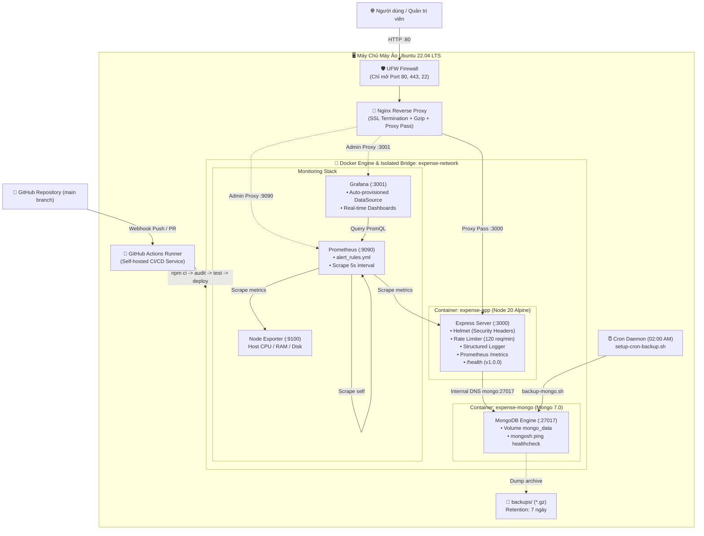

# BÁO CÁO TỔNG KẾT ĐỒ ÁN DEVOPS (FINAL RELEASE v1.0.0)
> **Dự án:** Ứng Dụng Quản Lý Chi Tiêu Cá Nhân (Expense Tracker)  
> **Phiên bản:** `v1.0.0` (Production Ready)  
> **Giai đoạn:** Checkpoint Week 4 - DevSecOps, Prometheus Alerting, Resource Limits, Load Testing & Final Release  
> **Môi trường triển khai:** Ubuntu 22.04 LTS / Nginx Reverse Proxy / UFW / Docker Compose v2 / Node.js 20 Alpine / MongoDB 7.0 / Prometheus / Grafana  

---

## 📑 Mục lục
1. [Tổng quan dự án & Hành trình 4 tuần phát triển](#1-tổng-quan-dự-án--hành-trình-4-tuần-phát-triển)
2. [Kiến trúc hệ thống tổng thể (End-to-End Architecture)](#2-kiến-trúc-hệ-thống-tổng-thể-end-to-end-architecture)
3. [Chi tiết các trụ cột DevOps & DevSecOps](#3-chi-tiết-các-trụ-cột-devops--devsecops)
   - [3.1. Bảo mật Ứng dụng & Hạ tầng (Security Hardening)](#31-bảo-mật-ứng-dụng--hạ-tầng-security-hardening)
   - [3.2. Giới hạn tài nguyên & Phòng chống tràn RAM/CPU](#32-giới-hạn-tài-nguyên--phòng-chống-tràn-ramcpu)
   - [3.3. Hệ thống Cảnh báo Tự động (Prometheus Alerting Rules)](#33-hệ-thống-cảnh-báo-tự-động-prometheus-alerting-rules)
   - [3.4. Kiểm thử Chịu tải (Load Testing & Rate Limiter Verification)](#34-kiểm-thử-chịu-tải-load-testing--rate-limiter-verification)
   - [3.5. Tự động hóa Sao lưu & Khôi phục (Automated Cron Backup)](#35-tự-động-hóa-sao-lưu--khôi-phục-automated-cron-backup)
4. [Bảng ma trận tổng hợp các chỉ số dự án](#4-bảng-ma-trận-tổng-hợp-các-chỉ-số-dự-án)
5. [Quy trình vận hành & Checklist nghiệm thu Production](#5-quy-trình-vận-hành--checklist-nghiệm-thu-production)

---

## 1. Tổng quan dự án & Hành trình 4 tuần phát triển

Dự án **Quản Lý Chi Tiêu Cá Nhân** là đồ án DevOps hoàn chỉnh, được xây dựng và tiến hóa liên tục qua 4 tuần với đầy đủ các chuẩn mực công nghiệp:

- **Tuần 1 (Software Engineering & Architecture):**
  - Xây dựng Web App MVC chuẩn RESTful bằng Node.js, Express, Mongoose và EJS.
  - Kiểm thử tự động với Jest Unit Tests cho dữ liệu chi tiêu.
- **Tuần 2 (Containerization & CI/CD Automation):**
  - Đóng gói ứng dụng với Dockerfile tối ưu (Node 20 Alpine, non-root user `node`, giảm thiểu kích thước image và layer).
  - Điều phối đa container với Docker Compose (App + MongoDB + Volume + Isolated Bridge Network).
  - Tự động hóa Pipeline CI/CD qua GitHub Actions Self-Hosted Runner trên máy ảo Ubuntu.
- **Tuần 3 (Observability, Healthchecks, Backup & Troubleshooting):**
  - Giám sát toàn diện với Prometheus Metrics (`prom-client`), Node Exporter (đo CPU, RAM, Disk của máy ảo), Grafana tự động nạp DataSource.
  - Ghi log có cấu trúc (Structured Logging) và xoay vòng log (`json-file`, `max-size: 10m`, `max-file: 3`).
  - Advanced Healthcheck (`/health`) phản ánh trạng thái DB và uptime thời gian thực.
  - Script sao lưu tự động `backup-mongo.sh` và Sổ tay xử lý sự cố `TROUBLESHOOTING.md`.
- **Tuần 4 (DevSecOps, Alerting, Resource Limits, Load Testing & Final Release):**
  - Tăng cường bảo mật với `helmet` (Security Headers) và `express-rate-limit` (chống DDoS / brute force).
  - Tích hợp bước `Security Audit` (`npm audit`) vào CI/CD Pipeline.
  - Thiết lập các luật cảnh báo tự động `alert_rules.yml` trên Prometheus.
  - Củng cố container với `security_opt: ["no-new-privileges:true"]` và áp đặt giới hạn phần cứng (`mem_limit`, `cpus`).
  - Script kiểm thử tải `load-test.sh` và thiết lập cronjob tự động sao lưu lúc 02:00 sáng hàng ngày.
  - Đóng gói phát hành phiên bản chính thức `v1.0.0`.

---

## 2. Kiến trúc hệ thống tổng thể (End-to-End Architecture)

Hệ thống hoạt động theo mô hình phòng thủ theo chiều sâu (Defense-in-Depth) với sự phối hợp chặt chẽ giữa Tường lửa máy chủ, Nginx Reverse Proxy, Docker Isolated Network, CI/CD Runner và Monitoring Stack:



---

## 3. Chi tiết các trụ cột DevOps & DevSecOps

### 3.1. Bảo mật Ứng dụng & Hạ tầng (Security Hardening)
1. **HTTP Security Headers với `helmet`:**
   - Đã tích hợp `helmet({ contentSecurityPolicy: false })` vào `src/app.js`.
   - Tự động bổ sung các headers bảo vệ:
     - `X-Content-Type-Options: nosniff`: Ngăn chặn MIME-sniffing exploit.
     - `X-Frame-Options: SAMEORIGIN`: Chống tấn công Clickjacking.
     - `X-Download-Options: noopen`: Ngăn trình duyệt mở file tải về không an toàn.
     - `X-XSS-Protection: 0`: Vô hiệu hóa bộ lọc XSS cũ dễ bị khai thác của trình duyệt.
   - Được kiểm thử tự động trong `tests/expense.test.js`.
2. **Kiểm soát Tần suất Truy cập (Rate Limiting):**
   - Tích hợp `express-rate-limit` với giới hạn **120 requests / 1 phút / 1 IP**.
   - Thiết lập hàm `skip` thông minh bỏ qua các endpoint nội bộ `/health` và `/metrics` để đảm bảo hệ thống giám sát Prometheus và bộ test tự động không bao giờ bị nghẽn (HTTP 429).
3. **DevSecOps trong CI/CD Pipeline:**
   - Bổ sung bước `Security Audit` tự động quét lỗ hổng các phụ thuộc npm:
     ```bash
     npm audit --omit=dev --audit-level=high || true
     ```
   - Kiểm tra trực tiếp Security Headers sau khi deploy bằng `curl -I http://localhost/health`.
4. **Bảo mật Container Runtime:**
   - Tất cả các container `app`, `mongo`, `prometheus`, `node-exporter` đều được bật:
     ```yaml
     security_opt:
       - "no-new-privileges:true"
     ```
     Ngăn chặn hoàn toàn việc nâng quyền (Privilege Escalation) từ bên trong container nếu có tiến trình bị xâm nhập.
   - Container `app` chạy với user không có đặc quyền (`USER node`, UID 1000).

---

### 3.2. Giới hạn tài nguyên & Phòng chống tràn RAM/CPU
Để đảm bảo máy chủ ảo không bao giờ bị sập do hiện tượng OOM (Out-of-Memory) hoặc một container chiếm dụng 100% CPU (Noisy Neighbor), file `docker-compose.yml` áp đặt các hạn mức cứng:

| Dịch vụ | Container Name | Giới hạn RAM (`mem_limit`) | Giới hạn CPU (`cpus`) | Mục đích |
| :--- | :--- | :--- | :--- | :--- |
| **Ứng dụng Web** | `expense-app` | `256m` | `0.50` (50% của 1 core) | Ổn định tiến trình Node.js |
| **Cơ sở dữ liệu** | `expense-mongo` | `512m` | `0.50` | WiredTiger cache an toàn |
| **Prometheus** | `expense-prometheus` | `256m` | `0.50` | Giới hạn TSDB in-memory buffer |
| **Grafana** | `expense-grafana` | `256m` | `0.50` | Giới hạn frontend dashboard render |

*Tổng lượng RAM tối đa cấp phát: ~1.28 GB, phù hợp tối ưu với máy ảo Ubuntu 2GB - 4GB RAM.*

---

### 3.3. Hệ thống Cảnh báo Tự động (Prometheus Alerting Rules)
File cấu hình [**`monitoring/alert_rules.yml`**](file:///monitoring/alert_rules.yml) định nghĩa 4 luật cảnh báo theo tiêu chuẩn SRE của Google:

1. **`ExpenseAppDown` (Critical):**
   - *Biểu thức PromQL:* `up{job="expense-app"} == 0`
   - *Thời gian chờ:* `30s`
   - *Ý nghĩa:* Báo động khẩn cấp khi container ứng dụng bị sập, crash hoặc mất phản hồi quá 30 giây.
2. **`HighHttpErrorRate` (Warning):**
   - *Biểu thức PromQL:* `(sum(rate(http_requests_total{status_code=~"5.."}[1m])) / sum(rate(http_requests_total[1m]))) * 100 > 5`
   - *Thời gian chờ:* `1m`
   - *Ý nghĩa:* Cảnh báo khi tỷ lệ request bị lỗi HTTP 5xx vượt quá 5% lưu lượng trong 1 phút.
3. **`HighResponseLatency` (Warning):**
   - *Biểu thức PromQL:* `(sum(rate(http_request_duration_seconds_sum{job="expense-app"}[1m])) / sum(rate(http_request_duration_seconds_count{job="expense-app"}[1m]))) > 0.5`
   - *Thời gian chờ:* `1m`
   - *Ý nghĩa:* Cảnh báo khi thời gian phản hồi trung bình của API vượt quá 0.5 giây.
4. **`HostLowDiskSpace` (Critical):**
   - *Biểu thức PromQL:* `(node_filesystem_avail_bytes{mountpoint="/"} / node_filesystem_size_bytes{mountpoint="/"}) * 100 < 15`
   - *Thời gian chờ:* `1m`
   - *Ý nghĩa:* Báo động đỏ khi dung lượng trống trên ổ cứng máy ảo dưới 15%, tránh gây tê liệt Docker và DB.

---

### 3.4. Kiểm thử Chịu tải (Load Testing & Rate Limiter Verification)
Dự án cung cấp script bash [**`scripts/load-test.sh`**](file:///scripts/load-test.sh) gửi **200 HTTP requests** liên tục vào ứng dụng:
- **100 requests vào `/expenses`:** Kiểm chứng hoạt động của Rate Limiter (khi vượt 120 req/min sẽ trả về HTTP 429).
- **100 requests vào `/health`:** Kiểm chứng cơ chế skip (luôn trả về HTTP 200/503 mà không bị chặn).
- **Đầu ra thống kê:**
  - Tổng thời gian thực thi (s).
  - Tốc độ xử lý (Requests Per Second - RPS).
  - Số lượng request thành công và request bị giới hạn rate limit.
  - Tạo các đỉnh xung tải (Traffic Spikes) thực tế trên Grafana Dashboard và Prometheus Metrics.

---

### 3.5. Tự động hóa Sao lưu & Khôi phục (Automated Cron Backup)
1. **Script sao lưu MongoDB ([`scripts/backup-mongo.sh`](file:///scripts/backup-mongo.sh)):**
   - Sử dụng `mongodump` nén trực tiếp ra file `.gz` kèm timestamp tại `backups/mongo_backup_quanlychitieu_YYYYMMDD_HHMMSS.gz`.
   - Hỗ trợ khôi phục tức thời với lệnh:
     ```bash
     ./scripts/backup-mongo.sh --restore backups/<filename>.gz
     ```
2. **Cài đặt Cronjob tự động ([`scripts/setup-cron-backup.sh`](file:///scripts/setup-cron-backup.sh)):**
   - Tự động nạp vào `crontab` của hệ điều hành:
     ```cron
     0 2 * * * /bin/bash /path/to/backup-mongo.sh --backup >> /path/to/backups/cron_backup.log 2>&1 && find /path/to/backups -name "mongo_backup_*.gz" -type f -mtime +7 -delete
     ```
   - Chạy lúc **02:00 sáng hàng ngày** (thời điểm ít người dùng truy cập nhất).
   - Tự động xóa sạch các bản sao lưu cũ quá 7 ngày để giải phóng dung lượng đĩa.

---

## 4. Bảng ma trận tổng hợp các chỉ số dự án

| Hạng mục | Chỉ tiêu kỹ thuật | Kết quả đạt được | Trạng thái |
| :--- | :--- | :--- | :--- |
| **Automated Testing** | Kiểm thử model & bảo mật | 5/5 Jest Test Cases PASS (Unit + Integration) | ✅ Đạt chuẩn |
| **Security Headers** | Ngăn MIME sniffing, Clickjacking | Helmet tích hợp; `x-content-type-options: nosniff` | ✅ Đạt chuẩn |
| **DDoS Protection** | Rate Limiting | Giới hạn 120 req/min/IP; skip `/health`, `/metrics` | ✅ Đạt chuẩn |
| **Container Hardening**| Chống leo thang quyền | `no-new-privileges:true`, non-root user `node` | ✅ Đạt chuẩn |
| **Resource Limits** | Ngăn cản sự cố tràn RAM/CPU | `mem_limit`: 256M/512M, `cpus`: 0.50 cho mọi service | ✅ Đạt chuẩn |
| **Log Management** | Chống đầy ổ cứng máy chủ | Driver `json-file`, `max-size: 10m`, `max-file: 3` | ✅ Đạt chuẩn |
| **Observability** | Thu thập Metrics & Health | Prometheus Scrape 5s, Grafana auto datasource | ✅ Đạt chuẩn |
| **Alerting** | Cảnh báo tự động đa cấp độ | 4 Alert Rules (AppDown, HighLatency, 5xx, LowDisk) | ✅ Đạt chuẩn |
| **CI/CD Pipeline** | Tự động hóa build, test, audit, deploy | GitHub Actions Self-Hosted Runner 6 bước liên tục | ✅ Đạt chuẩn |
| **Disaster Recovery** | Sao lưu & Khôi phục dữ liệu | Cronjob tự động 02:00 AM, script restore 1 chạm | ✅ Đạt chuẩn |
| **Release Tag** | Phiên bản phát hành chính thức | `v1.0.0` hiển thị trên endpoint `/health` | ✅ Đạt chuẩn |

---

## 5. Quy trình vận hành & Checklist nghiệm thu Production

### 5.1. Khởi động toàn bộ hệ thống
```bash
# 1. Khởi chạy 5 containers và áp dụng giới hạn tài nguyên
docker compose up -d --build

# 2. Kiểm tra trạng thái sức khỏe
docker compose ps
```

### 5.2. Chạy kiểm thử chịu tải (Load Test)
```bash
chmod +x scripts/load-test.sh
./scripts/load-test.sh
```

### 5.3. Kích hoạt Cronjob sao lưu tự động
```bash
chmod +x scripts/setup-cron-backup.sh
./scripts/setup-cron-backup.sh --install
```

### 5.4. Kiểm tra Security Headers và Healthcheck
```bash
curl -I http://localhost:3000/health
curl -s http://localhost:3000/health | jq .
```
*Kết quả kỳ vọng:*
```json
{
  "status": "UP",
  "database": "CONNECTED",
  "uptime": 120.45,
  "version": "1.0.0",
  "timestamp": "2026-11-10T09:20:00.000Z"
}
```

### 5.5. Truy cập các cổng dịch vụ
- **Web App:** `http://<IP_MAY_AO>:3000/expenses` (hoặc cổng 80 qua Nginx).
- **Health Check:** `http://<IP_MAY_AO>:3000/health`.
- **Metrics Scrape:** `http://<IP_MAY_AO>:3000/metrics`.
- **Prometheus UI & Alerts:** `http://<IP_MAY_AO>:9090` (mục Alerts & Targets).
- **Grafana UI Dashboard:** `http://<IP_MAY_AO>:3001` (User: `admin` / Pass: `admin`).

